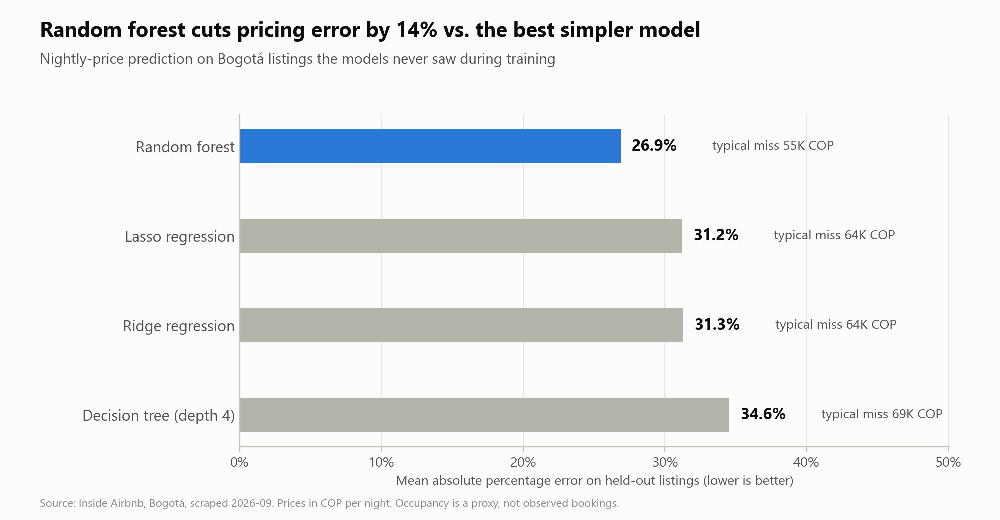
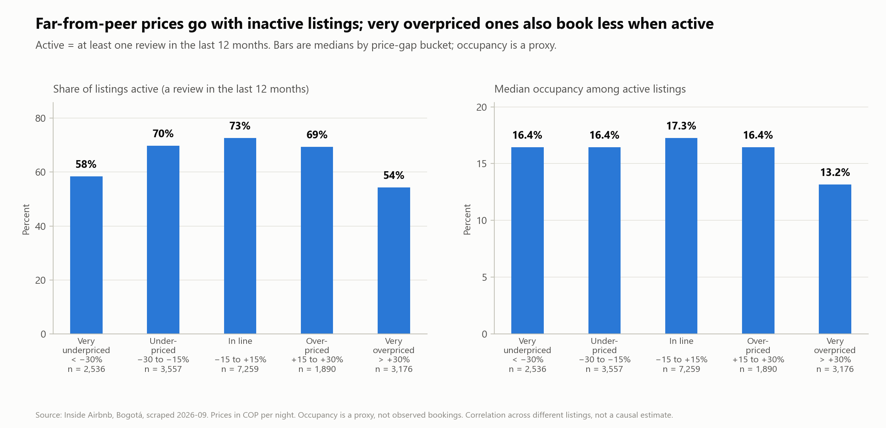
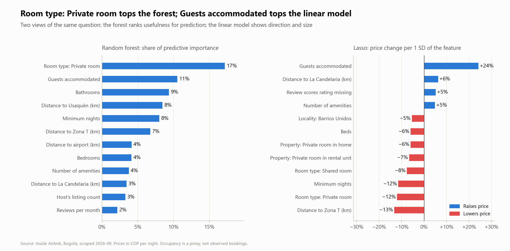

# Short-Term Rental Price Benchmarking: Bogotá, Colombia

Predicts a fair nightly price for every Airbnb listing in Bogotá, then flags listings priced far above
or below comparable listings, using **regression (Ridge/Lasso), a decision tree and a random forest**.

## Key results

- **Pricing model:** the random forest predicts nightly price within 26.9% on average (a typical miss of
  about 55K COP) for hosts it never saw in training, against 31.2% for Lasso.
- **Validation matters:** a plain random split reports 23.2% for the same forest, because hosts with many
  near-identical units leak across the split. The host-grouped number is the honest one.
- **Benchmark:** 3,176 of 18,418 listings are priced more than 30% above comparable listings and 2,536
  more than 30% below.
- **Does it matter for bookings?** Listings priced far from their peers are mostly inactive: 54% of very
  overpriced listings had a review in the last 12 months, against 73% of listings priced in line. Among
  active listings, very overpriced ones book about 15% less on average (bootstrap 95% CI: 10% to 19%).
  This is a correlation across listings, not a measured price effect.







## Business question

For a host or property manager: *Is this listing priced in line with comparable listings, and do
listings priced above their peers actually book less?* The deliverable is a benchmark (a fair price
and a gap per listing) plus a check of whether that gap relates to booking activity.

## Where each technique fits

| Technique | Role |
|---|---|
| Ridge / Lasso regression | Interpretable baseline. Coefficients quantify drivers; Lasso selects among correlated amenity flags. |
| Decision tree (depth 4) | Readable pricing rules a host can follow without software (`reports/tree_rules.txt`). |
| Random forest | Best predictive model; produces the out-of-fold fair price for every listing; feature importance for explanation. |

## Data

[Inside Airbnb](https://insideairbnb.com/), Bogotá, **detailed** `listings.csv.gz` scraped 2026-09-16,
committed at `raw/listings.csv.gz` (licensed CC BY 4.0). The summary `listings.csv` would not work: it
lacks bedrooms, capacity, amenities and locality.

Prices are in Colombian pesos (COP), trimmed to the 1st-99th percentile. Occupancy is a **proxy**, not
observed bookings: `estimated_occupancy_l365d / 365`, which Inside Airbnb derives from review counts (50%
review rate x average length of stay, capped at 70%; see
[their assumptions](https://insideairbnb.com/data-assumptions/)). If that column is absent the code falls
back to `1 - availability_365 / 365`, where hosts also block nights.

## Run

```bash
pip install -r requirements.txt
python -m src.run --listings raw/listings.csv.gz --group-by host            # hold out whole hosts (headline numbers)
python -m src.run --listings raw/listings.csv.gz                            # random split, for comparison
python -m src.run --listings raw/listings.csv.gz --group-by neighbourhood   # hold out whole localities
python -m src.run --listings raw/listings.csv.gz --with-optimizer           # also the experimental optimizer
```

A full run takes about 4 minutes on two CPU cores. Outputs in `reports/`: `price_model_comparison.csv`,
`lasso_coefficients.csv`, `forest_importance.csv`, `tree_rules.txt`, `price_gap_listings.csv` (every
listing with fair price, gap and flag), `price_gap_buckets.csv`, `price_gap_summary.json`.

Figures:
```bash
python -m src.eda --listings raw/listings.csv.gz --reports reports --source "Inside Airbnb, Bogotá, scraped 2026-09"
python -m src.plots --reports reports --source "Inside Airbnb, Bogotá, scraped 2026-09"
```
Titles are generated from the numbers, so they only claim what the data shows. Each figure's values are
in the CSV and JSON files above.

## Exploratory analysis

Six figures (`00a`-`00f` in `reports/figures/`), each one justifying a choice made later.

| Figure | Question it answers | Decision it supports |
|---|---|---|
| `00a_price_distribution.png` | Is price skewed? | Model log price; trim to the 1st-99th percentile |
| `00b_price_by_locality_room_type.png` | How much does location matter? | Locality, room type and distance-to-landmark features |
| `00c_price_by_size.png` | How does price scale with size? | Bedrooms and capacity as core features |
| `00d_missing_values.png` | Where is data missing? | Median imputation plus missing indicators; drop empty columns |
| `00e_occupancy_and_activity.png` | What does occupancy look like? | Treat occupancy as a proxy; separate active from inactive listings |
| `00f_listings_per_host.png` | How concentrated are hosts? | Hold out whole hosts when testing |

What it showed (18,418 listings after trimming):

- **Prices:** the highest raw price is 258M COP, about 1,600x the median (roughly 160K COP), so the
  untrimmed skew is 55.6. After the 1st-99th percentile trim it is 2.9, and 0.2 on a log scale. Hence log
  price and the trim.
- **Location and size:** among the 12 busiest localities, the median in Chapinero is 1.7x that in
  Kennedy. Median price rises about 36% per extra bedroom from 1 to 3 (groups above 3 bedrooms have under
  500 listings and are noisy).
- **Missing data:** 46 of 90 columns have gaps and 13 are entirely empty, including most host fields
  (`host_since`, `host_response_rate`, `host_acceptance_rate`, `instant_bookable`), so the models never
  saw host tenure or responsiveness. `bathrooms` is empty but is rebuilt from `bathrooms_text`.
- **Occupancy:** the median estimate is 7% and 33% of listings had no review in the past year. Because the
  estimate comes from reviews and is capped at 70%, inactive listings read about 0% by construction and 7%
  of listings sit at the cap.
- **Hosts:** hosts with 2+ listings own 70% of listings, and 85 hosts with 21+ listings own 17%, so a
  random split would leak near-identical units across train and test.

## Method

1. **Clean:** parse prices, trim outliers, parse amenities into counts and flags. Entirely empty columns
   are dropped with a printed warning.
2. **Features:** capacity, bedrooms/bathrooms, reviews, amenity flags, distance to Zona T / La Candelaria /
   Usaquén / El Dorado airport, room type, locality.
3. **Price models:** fit on log(price); report error back-transformed to pesos and percent (MAE, MAPE),
   plus R² on log price. Same held-out set for all four models.
4. **Fair price:** 5-fold out-of-fold random forest predictions, **grouped by host** so a host's
   near-identical units cannot leak into each other's benchmark.
5. **Price gap:** `price / fair_price - 1`. Listings beyond ±30% are flagged *for review*; the threshold
   sits above the model's typical error, so narrower flags would mostly be noise.
6. **Does the gap matter?** Compare occupancy across gap buckets and report the Spearman correlation
   between gap and occupancy within locality. Because a rank correlation is monotonic, the pipeline also
   checks for a **hump** (occupancy lower at both extremes than in the "in line" bucket) and reports, per
   bucket, the share of listings with a review in the last 12 months and occupancy among those active
   listings only, to separate under-booked listings from inactive ones.

## Results

Held-out price models (tuned random forest; **whole hosts held out of training**):

| Model | MAE (COP) | MAPE (%) | R² (log price) |
|---|---|---|---|
| Random forest | 54,643 | 26.9 | 0.655 |
| Lasso | 64,013 | 31.2 | 0.571 |
| Ridge | 64,023 | 31.3 | 0.569 |
| Decision tree (depth 4) | 69,258 | 34.6 | 0.476 |

A plain random split gave the forest 23.2% MAPE while leaving the linear models unchanged (31.1%).

Price gap (18,418 listings; 3,176 flagged overpriced and 2,536 underpriced at ±30%, close to the model's
typical host-grouped error of 28%):

| Price gap | Share active (review in last 12 months) | Median occupancy, active listings only |
|---|---|---|
| Very underpriced (< -30%) | 58.5% | 16.4% |
| Underpriced (-30 to -15%) | 69.8% | 16.4% |
| In line (-15 to +15%) | 72.7% | 17.3% |
| Overpriced (+15 to +30%) | 69.3% | 16.4% |
| Very overpriced (> +30%) | 54.3% | 13.2% |

Far-from-peer prices go with inactive listings: the raw median occupancy of 8.2% for listings priced in
line against 1.6% for very overpriced ones is mostly that. Among active listings occupancy is nearly flat,
except for very overpriced listings, whose mean estimated occupancy is about 15% lower than in-line
listings (bootstrap 95% CI: 10% to 19%). Medians are coarse here because the occupancy proxy takes few
distinct values, so the comparison uses means.

Key price drivers (`forest_importance.csv`, `lasso_coefficients.csv`): the forest ranks private room (17%
of importance), guests accommodated (11%), bathrooms (9%), distance to Usaquén (8%) and minimum nights
(8%) highest. In the Lasso, one standard deviation more guests accommodated goes with about +24% price,
while being a private room (-12%), longer minimum stays (-12%) and distance from Zona T (-13%) go with
lower prices. Importance shows what helps prediction; the Lasso shows direction and size; neither is
causal.

## Limitations

- Flags mean "review", not "wrong price": the model cannot see photos, cleanliness, view or host
  responsiveness.
- The gap-occupancy relationship is a correlation across different listings, not an experiment.
- Several host columns are empty in this scrape, so host tenure and responsiveness are not in the models.
- Occupancy is a review-based estimate, so it is not independent of review activity: listings with no
  recent reviews get about 0% by construction. The directly observed finding is the share of listings
  with a review in the last 12 months.
- The experimental optimizer (price x predicted occupancy) is off by default: on this data it pins most
  listings to the edge of the price band, which means the occupancy model has no usable price response,
  so its "uplift" would be an artifact.

## Ideas to extend

- SHAP values and partial dependence plots for the random forest
- Seasonality from `calendar.csv.gz` (Christmas/New Year, mid-year holidays, big events)
- A Streamlit app: enter listing features, get a fair-price range and its main drivers
- Time-based validation using two scrape dates
